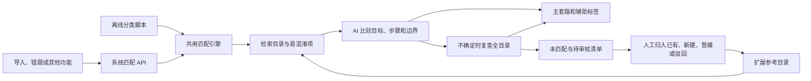

# 系统共用的题目—套路匹配能力

匹配引擎位于 `backend/routine_matching.py`，系统通过 `backend/routine_matching_api.py` 注册 `/routine-matching` 接口。离线分类脚本也调用相同引擎。其他功能传入题干和原解析即可使用，不必经过题库页面或读取题库数据库。



## 匹配如何判断

采用词项检索加 AI 判断：先根据题干和原解析检索候选，包含章节内所有套路以及易混淆项。检索只缩小范围；归属依据问题目标、关键步骤、排除条件和原文证据。没有检索证据时提供全部目录。

对于条件完整、有原解析但首次未匹配、中低置信度或提出新套路草案的题，再给模型整个目录的名称、步骤和排除条件复查，减少“检索没召回”被误认成“新套路”的情况。当前基础目录有 288 项，暂不依赖向量数据库或额外索引服务；后续通过 `match_question(..., retriever=...)` 注入向量检索或其他 RAG 检索器，保留匹配和审核契约。

普通确定匹配一次模型请求；全目录复查增加一次请求。每阶段独立重试，默认最多两次，因此最坏可有四次调用。原文引用必须连续出现在题干或原解析，所有编号必须属于该次提供的目录。检查能阻止虚构编号与引用，不能证明模型数学判断正确。

待审核项分为：

| kind | 含义 | 处理方式 |
|---|---|---|
| `new_routine_candidate` | 全目录复查仍无匹配，草案完整并附原文、相近套路排除理由 | 人工核对方法差异，修改草案后确认新建，或归入已有套路 |
| `insufficient_content` | 缺原解析、缺图或完整性未确认 | 补齐资料后重新匹配，不能直接当作新套路 |
| `ambiguous_match` | 综合题、归属不确定或新套路证据不足 | 确认主方法及辅助套路，不自动拆题 |
| `matching_incomplete` | 离线处理中请求失败或复查中断 | 按缓存续跑或重试失败项 |

草案含名称、板块、识别特征、检索词、步骤、排除条件、易混淆编号和别名。只有人工明确 `confirmed: true`、提供审核说明并核对当前目录哈希后，才能新建。数字或情境变化不应新建；AI 不调用人工确认接口。

## 对其他 Python 功能开放

引擎无需 FastAPI、数据库或文件写入。输入可直接构造；目录和模型适配器可注入，便于不同调用方复用和模拟测试：

```python
from backend.routine_classification import load_catalog, make_http_caller
from backend.routine_matching import question_record, match_question, build_review_entry

item = question_record(
    "设 A=(a,3)，B=(0,4)，求 A⊆B 时 a 的范围。",
    solution="先讨论 A 为空集，再在非空时比较区间端点。",
    categories=["集合与逻辑用语"], completeness="complete", id=101, version=1,
)
catalog = load_catalog()  # 也可传入人工确认后的扩展目录
# caller(system, user_json, item) -> JSON 字符串或对象，由调用方提供
matched = match_question(item, catalog, caller, attempts=2)
review = build_review_entry({"status": "classified", "item": item, **matched}, catalog)
```

`matched` 包含 `classification`、`retrieved_ids`、`catalog_audited`、`audit_pending`、`api_attempts`。`classification` 保留主辅助套路、置信度、证据、复核原因、草案及 `novelty_checks`。有人工修正的调用方应优先应用修正；系统 API 和离线脚本已实现这一点。

可选的 `retriever(item, catalog)` 返回目录记录列表；引擎只采用编号，并从权威目录重新读取规则，防止检索结果改变步骤或边界。默认词项检索；检索返回空列表时回退到全目录。`checkpoint(partial)` 可用于调用方保存两阶段进度，下一次传入 `initial` 续跑。自定义调用方若缓存结果，缓存键也应包含检索器及提示词版本。

调用方负责展示和后续业务行为。匹配不会自动保存题目、修改正式套路、选择正式母题或建立关联。目录编号如 `SET-017` 属于独立命名空间，不能当成 `mastery.db` 中的整数 `pattern_id`。

## 系统 API

路由已经在 `backend/main.py` 的静态页面挂载之前注册；启动新版系统后可调用。现有账号上下文与工作目录隔离继续生效。匹配使用当前账号的系统 AI 设置、默认老师的 solver 模型以及系统共享的服务商并发限制；接口不接受客户端指定密钥、地址、目录路径或数据库路径。游客入口仍按原有白名单控制，本轮没有开放游客新接口。

| 方法与路径 | 用途 | 副作用 |
|---|---|---|
| `GET /routine-matching/catalog` | 获取当前参考目录、版本与哈希 | 只读 |
| `POST /routine-matching/retrieve` | 返回检索候选及规则 | 无 AI，无文件写入 |
| `POST /routine-matching/match` | 执行 AI 匹配及必要的全目录复查 | AI 调用；默认把需复核项存进独立审核队列 |
| `GET /routine-matching/reviews` | 分页查看待审核项 | 只读；默认包含暂缓项 |
| `POST /routine-matching/reviews/{review_id}/decision` | 人工确认归入已有、新建、暂缓或驳回 | 只写参考目录与审核记录 |

`match` 与 `retrieve` 的题目字段遵循离线输入契约：

```json
{
  "id": 101,
  "version": 1,
  "question": "设 A=(a,3)，B=(0,4)，求 A⊆B 时 a 的范围。",
  "solution": "先讨论 A 为空集，再在非空时比较区间端点。",
  "answer": "a≥0",
  "categories": ["集合与逻辑用语"],
  "completeness": "complete"
}
```

`id`、`version` 默认 1，其他默认值同离线脚本。为已有题目传入稳定编号和实际版本，人工决定只对编号、版本及内容哈希均匹配的题生效。`match` 还支持 `save_review: false`，仅返回建议，不保存审核队列。默认完整性为 `unknown`，不会未经确认就推荐母题或宣称新套路。

响应带 `advisory_only: true`、目录哈希、匹配结果、主套路详情、审核项及是否保存。调用方可用 `review.kind` 呈现下一步；不用从自由文字猜测状态。API 请求失败返回 502，待调用方重试；没有 AI Key 返回 503。字段错误返回 422，旧目录/审核冲突返回 409。失败信息不会回传模型请求体或密钥。

审核请求例子（占位符需替换）：

```json
{
  "action": "create",
  "confirmed": true,
  "expected_catalog_hash": "从目录或匹配结果复制64位哈希",
  "note": "已对照相近套路，确认关键转化不同，补齐排除边界。"
}
```

`action` 可以是 `create`、`use_existing`、`defer`、`reject`。`use_existing` 还需 `routine_id`；`create` 可带完整 `draft` 覆盖 AI 草案，供人工修改名称与规则。新建权限沿用系统目录编辑权限，仅主人可以确认。暂缓项仍能稍后确认；已完成的决定重复提交相同请求不会重复新建，提交不同决定会报冲突。审核历史保留。

新建自动分配该板块下一个稳定编号，保留全部原编号，更新目录版本。并发确认通过文件锁与原子替换避免重复编号。目录超过 300 项仍可使用；200–300 是第一版规模目标。新建使其他旧目录下的新增建议过期，需要重新匹配，避免重复造套路；审核列表用 `catalog_stale` 标记，并返回当前目录哈希。人工可以继续把旧候选归入当前已有套路。

审核数据存于当前工作目录的 `routine-matching/state.json`；私有应用默认使用 `.runtime/routine-matching/state.json`。首次保存审核项时固定基础目录快照，此后从快照及人工扩展匹配。账号之间的数据隔离；同一账号的其他功能共用审核队列和扩展目录。状态文件把目录、审核项和决定作为一个整体原子保存。基础 `backend/routine_catalog.json` 不被覆盖，正式 `patterns.yaml` 和所有题库数据库也不被修改。若以后升级基础目录，需安排独立合并审核，不能静默替换已确认快照。

## 前端共用客户端

`frontend/routine-matching.js` 提供不依赖页面 DOM 的 ES module，导入不会发请求。可以在未来的导入页面、错题页面或工作台中按需使用：

```javascript
import { createRoutineMatcher } from '/routine-matching.js';
const matcher = createRoutineMatcher();
const result = await matcher.match({ question, solution, completeness: 'complete' });
// result.classification / result.review 交给本功能的界面展示
const queue = await matcher.reviews({ limit: 50 });
```

客户端还提供 `catalog`、`retrieve` 和 `decide`；支持注入 `fetcher`、配置 `baseUrl` 和传入 `AbortSignal`。后台逻辑与页面生命周期分开，本轮无需开发整套网站整理工作台。

## 验证边界

```bash
python3 -m unittest tests.test_routine_classification tests.test_routine_matching -v
```

测试使用模拟题、假模型响应、独立临时目录和仅挂载匹配路由的测试应用，不启动现有题库应用。覆盖漏检回退、新套路草案、资料不足、重试和复查中断恢复、人工修正、目录扩展、并发确认、暂缓后再审核、接口权限和工作目录隔离。真实 AI 的数学判断准确率仍需在稳定快照上试分验证。
